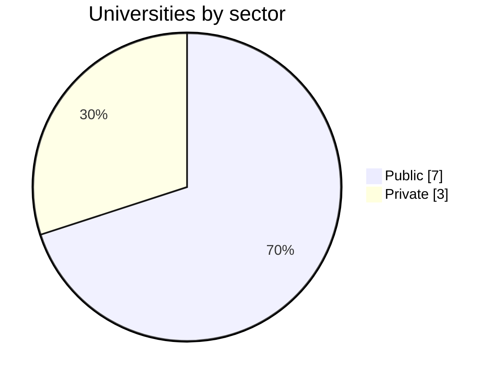
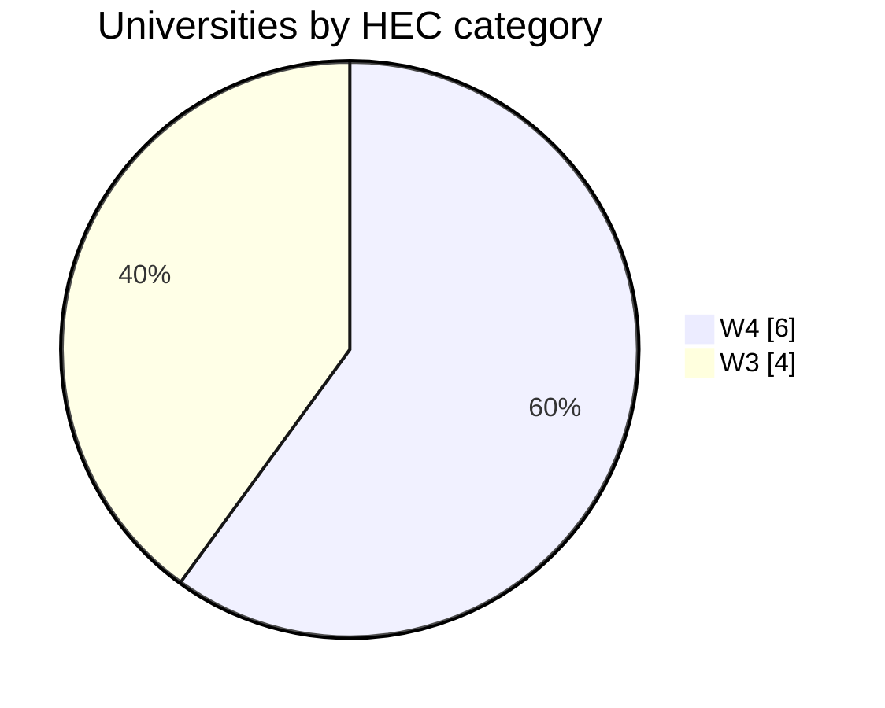
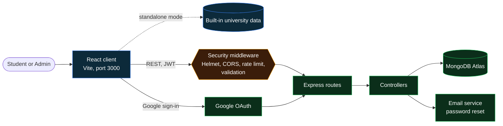
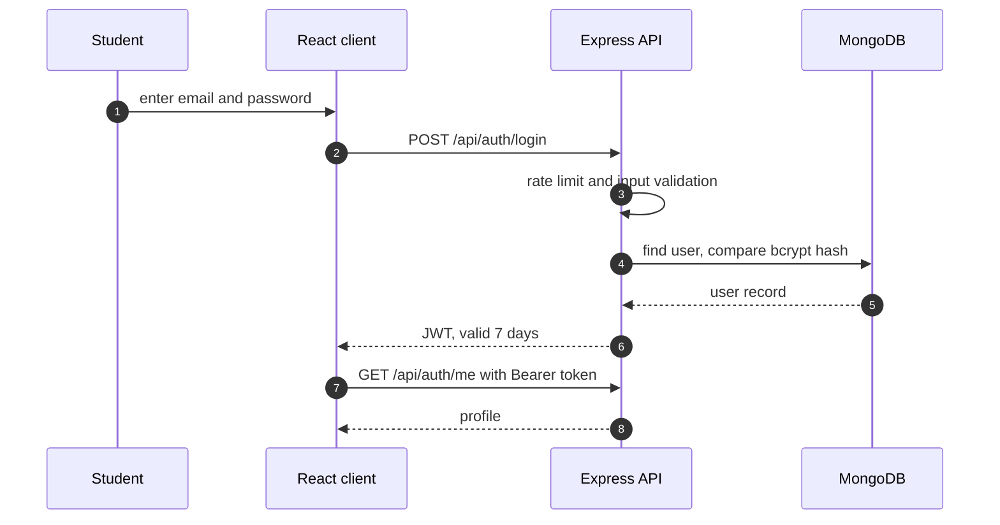
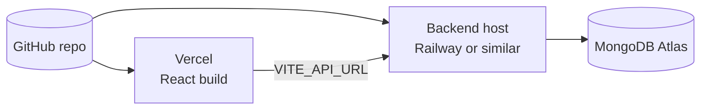

<div align="center">


<br>


**Full stack web application** for students choosing a university in Islamabad

[Overview](#overview) · [Features](#features) · [Architecture](#architecture) · [Quick start](#quick-start) · [API](#api-reference) · [Security](#security) · [Deployment](#deployment)

</div>

---

## Overview

Choosing a university means opening a dozen websites and comparing fee structures, deadlines and entry tests by hand. **Islamabad Universities Hub** puts the information for **10 HEC-recognised Islamabad institutions** into one portal: admissions, fees, programs, facilities, scholarships and news, plus side-by-side comparison and a chatbot for quick questions.

The frontend is designed to work **standalone** with the university data built in, so the site can be viewed without any backend. The backend adds accounts, admission tracking, scholarships, announcements and an admin dashboard.

## Features

| Area | What you get |
|---|---|
| **University directory** | 10 Islamabad universities with filters |
| **Detail pages** | 10 tabs per university: Overview, Admissions, Fees, Programs, Facilities, Rules, Faculty, Gallery, Student Portal, Careers |
| **Comparison** | Compare up to 3 universities side by side |
| **UniBot chatbot** | Answers questions on fees, rankings, programs, admission process, deadlines, scholarships and entry tests (NET, QAU-NET, MDCAT and more) |
| **Scholarship finder** | Browse all scholarship programs |
| **News and announcements** | Latest admission news, managed by admins |
| **Student accounts** | Email registration and Google OAuth, password reset by email |
| **Admission tracking** | Submit and follow an application in the student portal |
| **Admin dashboard** | Full CRUD on universities, stats, users and announcements |
| **Appearance** | Dark and light mode, fully responsive on mobile and desktop |

## Coverage at a glance





| # | University | Type | HEC |
|---|---|---|---|
| 1 | Quaid-i-Azam University (QAU) | Public | W4 |
| 2 | COMSATS University Islamabad (CUI) | Public | W4 |
| 3 | National University of Sciences and Technology (NUST) | Public | W4 |
| 4 | Allama Iqbal Open University (AIOU) | Public | W4 |
| 5 | International Islamic University (IIUI) | Public | W4 |
| 6 | FAST National University (FAST-NUCES) | Private | W4 |
| 7 | Bahria University Islamabad (BU) | Public | W3 |
| 8 | Air University Islamabad (AU) | Public | W3 |
| 9 | Riphah International University | Private | W3 |
| 10 | University of Lahore, Islamabad Campus | Private | W3 |

## Architecture



### Sign-in flow



### Technology

| Layer | Stack |
|---|---|
| **Frontend** | React, Vite |
| **Backend** | Node.js 18+, Express |
| **Database** | MongoDB Atlas |
| **Auth** | JWT (7-day expiry), bcrypt (12 rounds), Google OAuth |
| **Security** | Helmet, CORS, rate limiting, express-validator |
| **Hosting** | Vercel (frontend), Railway or any Node host (backend) |

### Project structure

```text
islamabad-uni-hub/
├── client/                React frontend (Vite)
│   └── src/
│       ├── components/    Navbar, Cards, ChatBot, ...
│       ├── pages/         Home, Universities, Compare, ...
│       └── data/          built-in university data
└── server/                Node.js + Express backend
    ├── controllers/
    ├── models/
    ├── routes/
    ├── middleware/
    ├── utils/
    └── server.js
```

## Quick start

**Requirements:** Node.js 18+, npm 9+, and a free MongoDB Atlas account (only for the backend).

### 1. Frontend (works on its own)

```bash
git clone https://github.com/<your-username>/islamabad-uni-hub.git
cd islamabad-uni-hub/client
npm install
npm run dev
```

Open **http://localhost:3000**. All university data is built in, so no backend is needed to browse the site.

### 2. Backend (for accounts, tracking and admin)

```bash
cd islamabad-uni-hub/server
npm install
cp .env.example .env      # Windows: copy .env.example .env
npm run dev
```

Server: **http://localhost:5000** · Health check: **http://localhost:5000/api/health**

| Variable | Purpose |
|---|---|
| `MONGO_URI` | MongoDB Atlas connection string |
| `JWT_SECRET` | Random string of 64 or more characters |
| `EMAIL_USER` | Gmail address used to send password-reset mail |
| `EMAIL_PASS` | Gmail **App Password** (not your normal password) |

<details>
<summary><b>MongoDB Atlas setup (free tier)</b></summary>

1. Create an account at [mongodb.com/atlas](https://mongodb.com/atlas) and create a free cluster
2. **Database Access**: add a user with a strong password
3. **Network Access**: for local development you can allow `0.0.0.0/0`. For production, restrict access where your host allows it
4. **Connect, Drivers**: copy the connection string
5. Paste it into `.env` as `MONGO_URI`

</details>

<details>
<summary><b>Troubleshooting</b></summary>

| Problem | Fix |
|---|---|
| `npm install` fails | Check `node -v` is 18 or higher |
| Backend cannot connect to MongoDB | Check the connection string, password special characters, and Atlas Network Access |
| CORS error in the browser | Make sure the frontend URL is the allowed origin in the server settings |
| No password-reset email | Use a Gmail App Password and enable 2-step verification on the account |
| Frontend shows data but login fails | The backend is not running, start it in `server/` |

</details>

## Pages

| Page | Path | Description |
|---|---|---|
| Home | `/` | Hero, featured universities, news, scholarships, FAQ |
| Universities | `/universities` | All 10 universities with filters |
| University detail | click any card | 10 tabs of complete information |
| Compare | `/compare` | Side-by-side comparison |
| Scholarships | `/scholarships` | All scholarship programs |
| News | `/news` | Latest admission news |
| Contact | `/contact` | Contact form and FAQ |
| Auth | `/auth` | Login and registration |
| Admin | `/admin` | Admin dashboard |

## API reference

<details open>
<summary><b>Authentication</b></summary>

| Method | Endpoint | Access |
|---|---|---|
| POST | `/api/auth/register` | public |
| POST | `/api/auth/login` | public |
| POST | `/api/auth/google` | public |
| GET | `/api/auth/me` | signed in |
| POST | `/api/auth/forgot-password` | public |
| POST | `/api/auth/reset-password` | public |

</details>

<details>
<summary><b>Universities</b></summary>

| Method | Endpoint | Access |
|---|---|---|
| GET | `/api/universities` | public |
| GET | `/api/universities/search?q=nust` | public |
| GET | `/api/universities/compare?ids=id1,id2,id3` | public |
| GET | `/api/universities/:id` | public |
| POST | `/api/universities` | admin |
| PUT | `/api/universities/:id` | admin |
| DELETE | `/api/universities/:id` | admin |

</details>

<details>
<summary><b>Admissions, scholarships and admin</b></summary>

| Method | Endpoint | Access |
|---|---|---|
| GET | `/api/admissions/my` | signed in |
| POST | `/api/admissions` | signed in |
| GET | `/api/admissions/:id/track` | signed in |
| PUT | `/api/admissions/:id/status` | admin |
| GET | `/api/scholarships` | public |
| GET | `/api/admin/stats` | admin |
| GET | `/api/admin/users` | admin |
| POST | `/api/admin/announcements` | admin |

</details>

## Security

| Control | Details |
|---|---|
| **Secure headers** | Helmet |
| **CORS** | Restricted to the allowed domain |
| **Rate limiting** | 100 requests per 15 minutes, 10 for authentication routes |
| **Authentication** | JWT with 7-day expiry |
| **Password storage** | bcrypt, 12 rounds |
| **Input validation** | express-validator on incoming data |
| **NoSQL injection** | MongoDB injection prevention |
| **Transport** | HTTPS in production |

## Deployment



**Frontend on Vercel**

```bash
cd client
npm run build
npx vercel --prod
```

Set `VITE_API_URL` to `https://your-backend-domain/api` in the Vercel project settings.

**Backend on Railway or any Node host**

1. Push the repository to GitHub
2. Create a new project from the repo and set the root directory to `server/`
3. Add every variable from `.env` in the host's settings
4. Deploy. Most hosts redeploy on every push

## Data notice

University fees, deadlines, seat numbers and entry-test dates change every admission cycle. Always confirm current details on the official university website before applying. This portal is an information aid, not an official channel of any university.

## Team

Built by **Sana Ullah**

## Contact

- Email: info@islamabadunihub.pk

---

<div align="center">

Islamabad Universities Hub · 2025 · Built for Pakistani students

</div>
